# fam.ly

A private, family-only app for a busy household: **who's home, who's out and where, who has the car, what's for dinner, who's coming to stay, and what needs doing**. It's a phone-first web app (install it to your home screen) with real push notifications, built for one family at a time. Nothing is tracked: everyone taps to say where they are.

Every family runs its own copy on free tiers (Supabase + Cloudflare), so your family's data lives in your own accounts and nobody else's.

> **Using an AI coding agent (Claude Code, Codex, Cursor…)?** Give it this repository's link and say *"set up fam.ly for my family"*. [`AGENTS.md`](AGENTS.md) walks it through everything, from an empty machine to your family's own live app, starting from a blank slate.

## Screenshots

The screenshots use a made-up demo family (the Carters).

| | | |
|---|---|---|
| 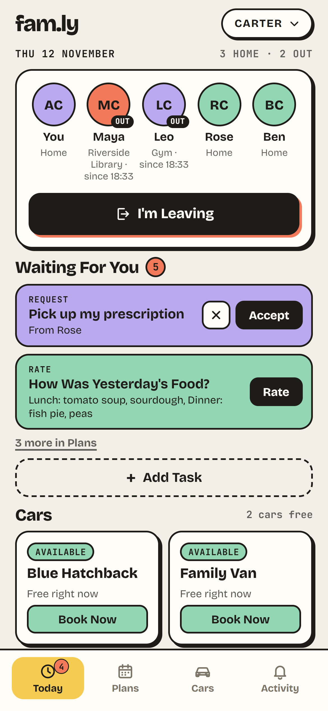 **Today**: who's home or out (and where), what needs you, which cars are free | 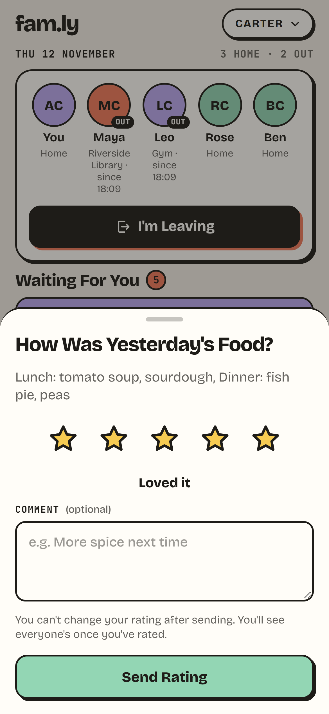 **Rate the food**: at 10pm everyone who accepted the menu is asked for 1–5 stars | 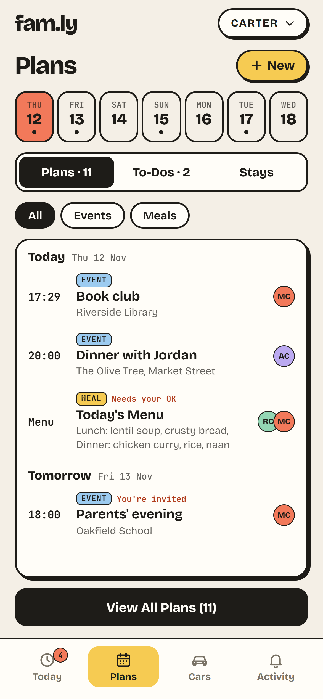 **Plans**: events, menus and stays for the next two weeks, repeating plans included |
| 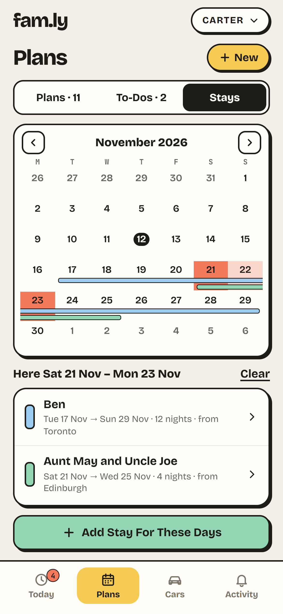 **Stays**: who's visiting and when; tap two days to see who's here | 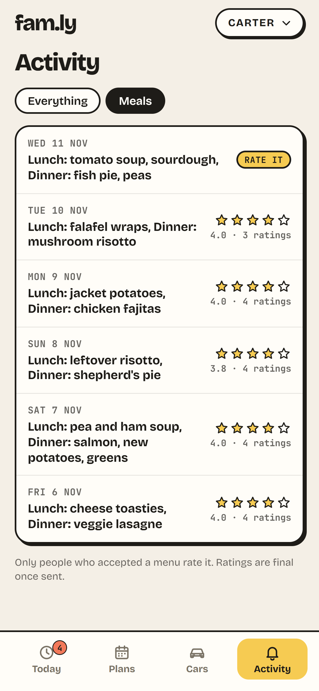 **Meals**: every past menu and how it was rated | 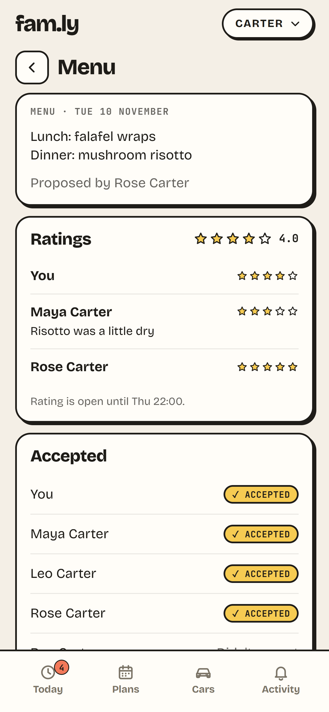 **Ratings**: everyone's stars and comments (hidden until you've rated) |
| 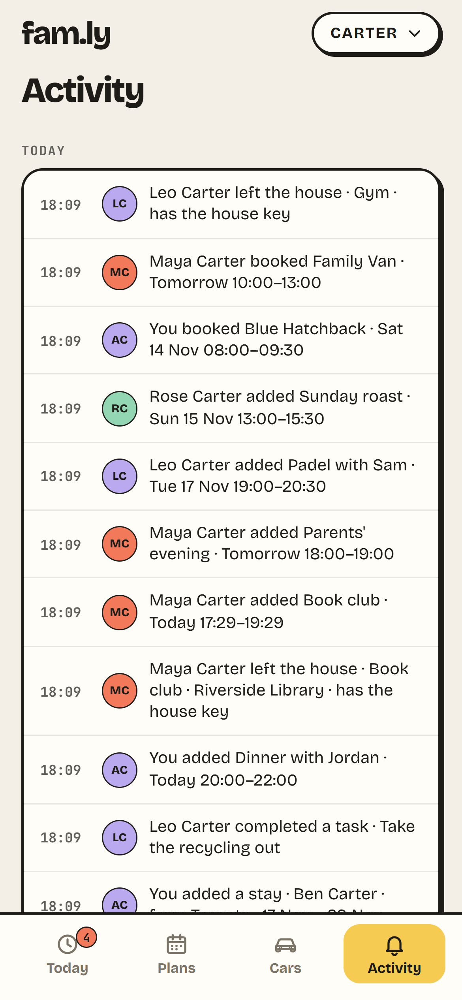 **Activity**: departures, returns, bookings and plans as they happen | 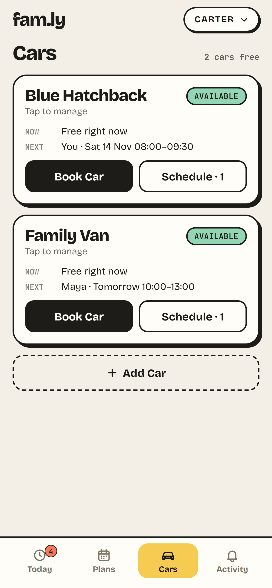 **Cars**: book a car, see its schedule, know when it's back | 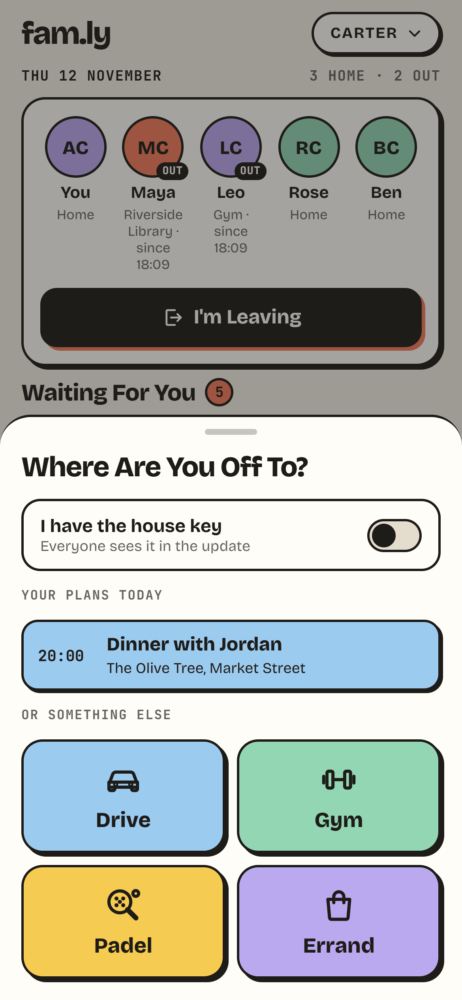 **I'm Leaving**: pick one of today's plans or Drive / Gym / Padel / Errand |
| 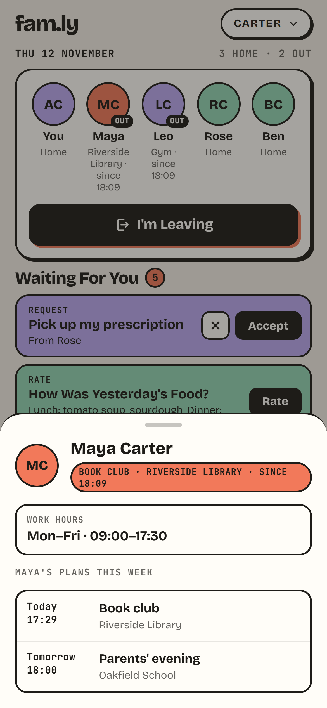 **Profiles**: tap anyone to see where they are, their work hours and plans | 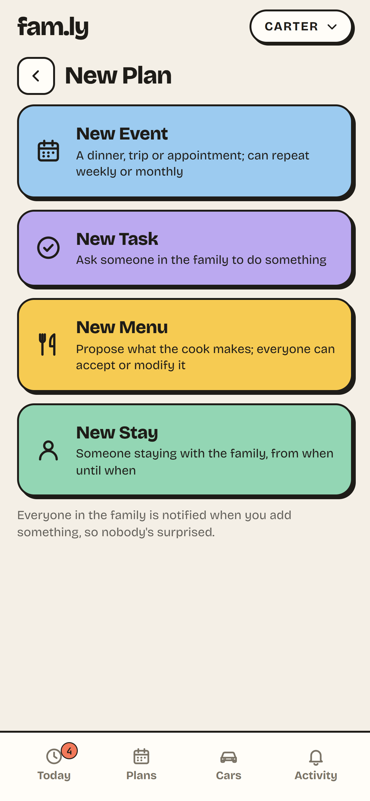 **New plan**: event, to-do, menu or stay; the family is told | 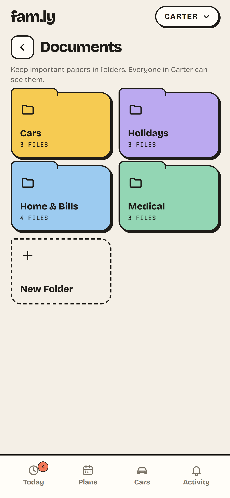 **Documents**: the family's important papers in shared folders |
| 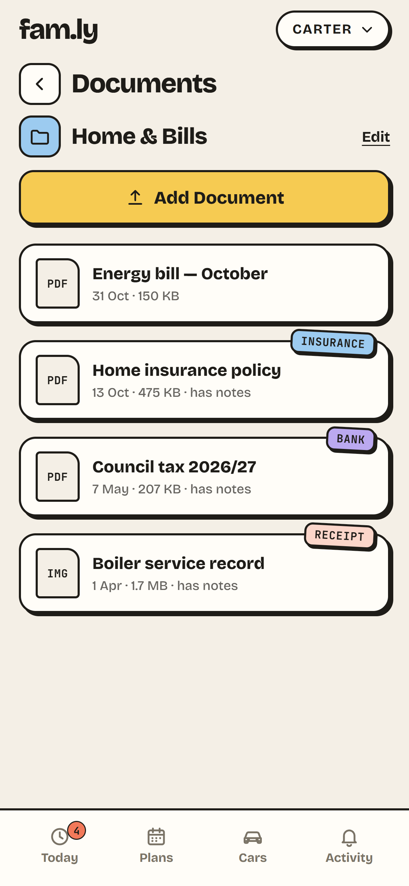 **Folders**: PDFs, photos and scans, each with an optional label sticker | 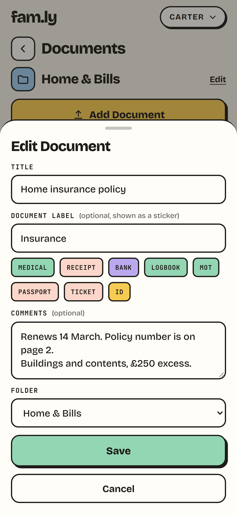 **Edit a document**: rename, relabel, add notes or move it to another folder | |

## What it does

| Area | What you get |
|---|---|
| **Who's where** | One tap "I'm Leaving" (for a plan, a drive, the gym, padel or an errand) and "I'm Home". Today shows everyone as Home, Out (with the plan's place) or Work (from their set hours). The house key travels with whoever says they have it. |
| **Cars** | Shared cars with bookings that can't overlap (enforced in the database), quick "Now / Tonight / Tomorrow" booking, maintenance blocks, "I've left / I'm home" on a trip with gentle reminders if someone's late. |
| **Plans** | Events with invites and RSVPs, optionally repeating (daily, weekly, fortnightly, monthly). Leaving for a plan tells the family where you've gone. |
| **Stays** | Family or guests staying for a few days or weeks, on a month calendar; tap a range to see who's here. |
| **Menus** | Propose the day's menu; everyone accepts or suggests a change. At 10pm, everyone who accepted rates it (1–5 stars and a comment, final once sent). Activity → Meals keeps the history. |
| **To-dos** | Ask someone to do something; they accept or decline; a 6pm reminder lists anything still open. |
| **Notifications** | Real web push on iPhone (home-screen app, iOS 16.4+) and Android, with what happened in the text ("Maya has left the house · Book club · Riverside Library"). Quiet hours and per-category switches. |
| **Documents** | Shared folders in Settings → Documents for passports, insurance, bills and the like. Add a PDF, photo or scan (up to 25 MB), give it a label sticker and notes, move it between folders. Everyone in the family sees every folder. |
| **Privacy** | Invite-only sign-in with 6-digit email codes. Row-level security on every table: a family only ever sees its own data. No location tracking. Data export and deletion built in. |

## Try it on your computer (10 minutes)

Needs **Node 22+**, **pnpm 10** (`corepack enable`), and **Docker Desktop** running.

```sh
pnpm install
pnpm db:start                      # local Supabase in Docker (database, auth, email catcher)
pnpm db:reset                      # applies every migration from scratch
cp apps/web/.env.example apps/web/.env.local
pnpm exec supabase status -o env   # copy API_URL and ANON_KEY into apps/web/.env.local
pnpm --filter @famly/web dev       # http://127.0.0.1:5173
```

Sign in as `founder@test.local`. The code arrives in the local mail catcher at http://127.0.0.1:54324. You'll start with an empty family of your own.

**Want the demo family instead?** Follow the three steps at the top of [`supabase/demo/demo_family.sql`](supabase/demo/demo_family.sql). `node tools/screenshots/capture.mjs` regenerates the screenshots above from it.

## Run it for your family

See [`AGENTS.md`](AGENTS.md): it's written for an AI agent but reads fine as a human checklist. In short: a free Supabase project (database, sign-in, push sender), a free Cloudflare account (hosts the web app), optionally a domain and a Resend account for sign-in emails. Expect about an hour by hand.

## Checks

```sh
pnpm typecheck
pnpm --filter @famly/domain test   # time, repeat and status rules
pnpm exec supabase test db         # 500+ pgTAP tests: RLS, constraints, every RPC, notifications
pnpm test:concurrency              # parallel booking harness
```

## How it's built

- `apps/web`: React 19 + Vite PWA, served by Cloudflare Workers static assets. No server of its own.
- `supabase/migrations`: the whole backend. Tables, row-level security and `rpc_*` functions (all writes go through RPCs), plus `pg_cron` jobs for reminders, ratings and retention.
- `supabase/functions`: `push-dispatch` (Web Push via VAPID) and `health-check`.
- `packages/domain`: shared rules (time zones, repeats, status, error messages), unit-tested.

## Licence

[MIT](LICENSE). Use it, change it, run it for your family.
